# WorldSim AI — Autonomous Decision Intelligence & Simulation Platform

> **Test decisions in simulation before committing them to reality.**  
> WorldSim AI empowers leaders, operators, and analysts to describe real-world operational challenges in natural language, automatically construct discrete-event simulation models, evaluate counterfactual strategies across multi-criteria Pareto frontiers, and receive truth-verified plain-English executive decision reports.

---

## 🌟 Key Features

- **Natural Language to Operational Model**: Describe an operational bottleneck (e.g., hospital emergency room surge, municipal permitting backlog, college course waitlists) in plain English.
- **5 Comprehensive Domain Scenario Packs**:
  - 🏥 **Hospital ED Operations**: Doctors, nurses, triage stations, beds, clinical delays, and patient costs.
  - 🎓 **Higher Education Course Allocation**: Department waitlists, classroom capacity, faculty teaching loads, and tuition efficiency.
  - 🏢 **Workplace Hybrid Scheduling**: Hot-desk contention, mid-week attendance peaks, meeting room rejections, and real estate overhead.
  - 🏛️ **Municipal Permitting Bureau**: Reviewer backlogs, field inspections, commercial zoning delays, and municipal administration costs.
  - 🏟️ **Public Event Crowd Safety**: Magnetometer ingress lanes, turnstile throughput, crowd crush risk, and gate operations.
- **15 Pre-Configured Scenario Templates**: 3 calibrated templates per domain with instant auto-configuration.
- **Deterministic Monte Carlo Parallelism**: SimPy 4.1 discrete-event models executed concurrently across CPU cores via `ProcessPoolExecutor` with seed-based mathematical reproducibility.
- **Plain-English Executive Decision Brief**:
  - Bottom-line strategy recommendation in plain, everyday language.
  - 4 Key KPI Impact Cards: Speed/Delay, Risk/Peak Protection, Resource Efficiency, and Financial Cost.
  - Transparent "Why This Is The Best Choice" and "The Honest Trade-Off" disclosures.
  - Practical 3-step rollout action plan.
- **Multi-Criteria Pareto Frontier Scoring**: Live sliders for Time, Risk, Efficiency, and Cost weights with zero-latency client-side re-ranking.
- **Interactive Visual Analytics**: 4 synchronized chart modes (Time vs. Cost Bar, % Delta vs. Baseline, Cost vs. Risk Scatter, and Leaderboard).
- **What-If Scenario Sandbox**: Modify parameters interactively and test counterfactual hypotheses in real-time.
- **Truth Preservation & Critic Veracity**: Automatic programmatic auditing by `CriticAgent` to ensure that every metric cited in the narrative report corresponds 100% faithfully to empirical simulation runs.

---

## 🏛️ System Architecture

```mermaid
flowchart LR
    A["Natural Language Prompt / Scenario Template"] --> B["RouterAgent\n(Semantic Pack Matching)"]
    B --> C["ScenarioBuilderAgent\n(Schema Parameter Extraction)"]
    C --> D["StrategyGeneratorAgent\n(Counterfactual Formulations)"]
    D --> E["MonteCarloRunner\n(SimPy Parallel Discrete Event Engine)"]
    E --> F["Scorer & Pareto Frontier\n(Time, Risk, Efficiency, Cost)"]
    F --> G["ReporterAgent\n(Plain-English Executive Brief)"]
    G --> H["CriticAgent\n(Truth & Numeric Veracity Audit)"]
    H --> I["Next.js Web Studio\n(Plain Brief + Charts + Live Sliders + What-If)"]
```



---

## 📚 Documentation Index

For in-depth architectural and developer documentation, explore our `docs/` library:

- 📖 **[System & User Guide](docs/SYSTEM_GUIDE.md)**: Complete walkthrough of the Web Studio, template library, plain-English brief, charts, live sliders, and What-If sandbox.
- 📐 **[System Architecture](docs/ARCHITECTURE.md)**: End-to-end design diagrams, agent pipeline sequence, SimPy runner concurrency, and degradation hierarchy.
- 📦 **[Scenario Packs Reference](docs/SCENARIO_PACKS.md)**: Deep dive into all 5 domain packs, schemas, TOML distributions, and simulation metrics.
- 🔌 **[API Reference Manual](docs/API_REFERENCE.md)**: Complete REST API documentation, request/response JSON schemas, and curl examples.
- 🚀 **[Vercel & Cloud Deployment Guide](docs/VERCEL_DEPLOYMENT.md)**: Step-by-step instructions for deploying to Vercel, linking container backends (Railway/Render), and standalone demo mode.
- 🛠️ **[Developer & Contributor Guide](docs/DEVELOPER_GUIDE.md)**: Step-by-step tutorial on adding new scenario packs, running tests, and local setups.

---

## 🚀 Quickstart: Running Locally

### Prerequisites
1. **Python 3.12+** with the `uv` package manager installed
2. **Node.js 20+** (default Windows path: `C:\Program Files\nodejs`)
3. A Google Gemini API key configured in `.env`:
   ```bash
   cp .env.example .env
   # Add your key to .env:
   # GEMINI_API_KEY=your_gemini_api_key_here
   ```

### Start Both Servers

Open **two terminal windows** in `worldsim/`:

#### Terminal 1: Backend Server (FastAPI + SimPy Engine)
```powershell
uv run python run_api.py
```
- **Backend URL**: [http://localhost:8000](http://localhost:8000)
- **API Health Check**: [http://localhost:8000/api/v1/health/live](http://localhost:8000/api/v1/health/live)
- **Interactive Swagger Docs**: [http://localhost:8000/api/docs](http://localhost:8000/api/docs)

#### Terminal 2: Frontend Web Studio (Next.js)
```powershell
$env:PATH = "C:\Program Files\nodejs;$env:PATH"
npm run dev
```
*(On `cmd.exe`: run `set PATH=C:\Program Files\nodejs;%PATH%` followed by `npm run dev`)*
- **Web Studio**: [http://localhost:3000](http://localhost:3000)

---

## 🧪 Verification & Testing Suite

WorldSim AI includes a comprehensive automated test suite verifying agent routing, parameter extraction, simulation determinism, pack registration, and API endpoints:

```powershell
# Run the entire backend test suite (14 passing tests)
uv run pytest -v

# Run agent and critic tests specifically
uv run pytest tests/test_agents.py -v

# Run discrete-event simulation & pack tests
uv run pytest tests/test_simulation.py -v

# Validate frontend production build (Turbopack + TypeScript)
$env:PATH = "C:\Program Files\nodejs;$env:PATH"
npm run build
```

---

## 🛡️ License & Standards
Developed for high-stakes decision intelligence with zero-hallucination guarantees, deterministic reproducibility, and accessible plain-language reporting.
