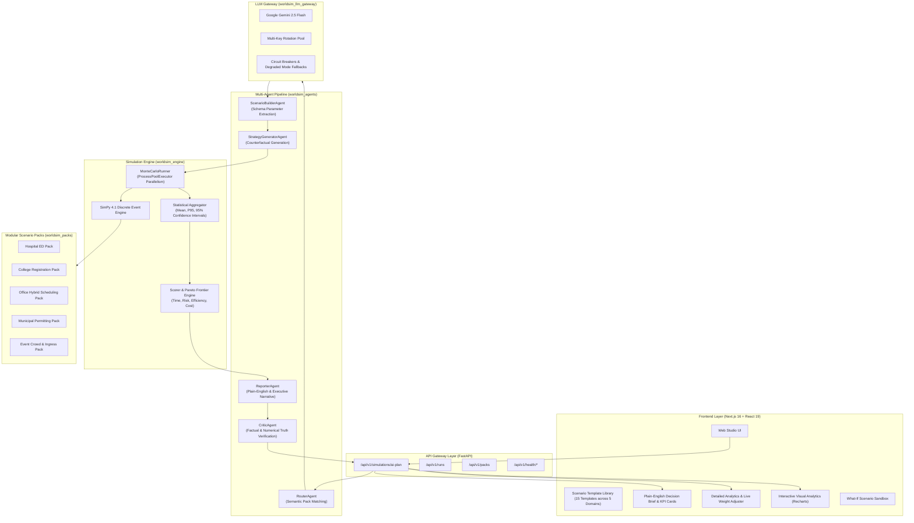
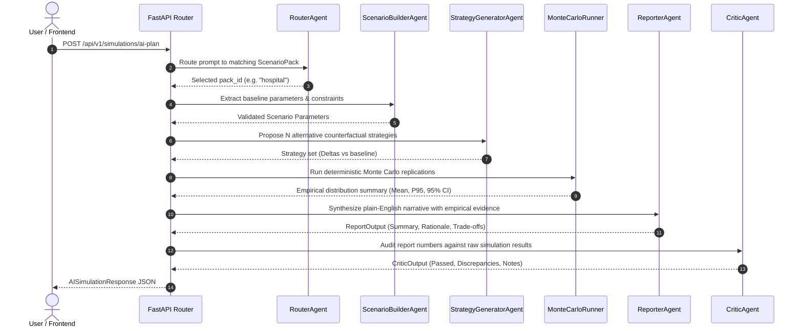

# WorldSim AI — Comprehensive System Architecture

WorldSim AI is a deterministic, multi-agent simulation platform designed to evaluate high-stakes operational and strategic decisions in natural language before executing them in the real world.

The system combines **LLM-driven multi-agent orchestration** with a **rigorous discrete-event simulation engine (SimPy)**, **Monte Carlo parallelism**, **multi-criteria Pareto frontier scoring**, and **truth-preserving critic auditing**.

---

## 1. High-Level Architecture Diagram

---

## 2. Component Layers & Responsibility

### Layer 1: Frontend Client (`apps/web`)
Built on Next.js 16 (Turbopack) and React 19, the user interface provides an interactive, zero-gradient, flat-design control room:
1. **Scenario Template Switcher**: 15 pre-calibrated scenario templates spanning 5 operational domains (`Hospital`, `College`, `Office`, `Govt Policy`, `Event Safety`).
2. **Dual-Mode Results Presentation**:
   - **Plain-English Brief**: Translates simulation metrics into accessible language, highlighting the bottom-line recommendation, 4 key KPI impact cards (Speed, Risk, Efficiency, Cost), honest trade-offs, and an actionable 3-step rollout plan.
   - **Detailed Analytics**: Displays the full Monte Carlo evaluation matrix with 95% confidence intervals, empirical distributions, and veracity status.
3. **Dynamic Visual Analytics**: 4 synchronized Recharts views:
   - *Time vs Cost Bar Chart*
   - *% Delta vs Baseline Improvement Chart*
   - *Cost vs Risk Scatter Matrix*
   - *Composite Score Leaderboard*
4. **Live Weight Adjustment**: Interactive sliders for Time, Risk, Efficiency, and Cost weights that recalculate composite decision scores and Pareto frontiers client-side with zero latency.
5. **What-If Scenario Sandbox**: Lets users manually adjust parameters and rerun counterfactual simulations.

---

### Layer 2: API Gateway (`apps/api`)
Built with FastAPI, Uvicorn, and Pydantic v2:
- **`POST /api/v1/simulations/ai-plan`**: End-to-end multi-agent execution pipeline. Accepts a free-form prompt or explicit pack override, runs counterfactual simulations, and returns a verified executive report.
- **`POST /api/v1/runs`**: Direct execution of Monte Carlo simulations given explicit strategy parameters.
- **`GET /api/v1/packs`**: Discovers and returns metadata and schemas for all registered scenario packs.
- **`GET /api/v1/health/live` & `GET /api/v1/health/ready`**: Production liveness and readiness probes.

---

### Layer 3: Multi-Agent Orchestration Pipeline (`packages/agents`)

1. **RouterAgent**:
   - Analyzes user prompt against all registered pack manifests.
   - Computes semantic match scores and returns the best `pack_id`.
   - *Fallback*: Fallback keyword matching ensure zero execution stalls if LLM is unreachable.

2. **ScenarioBuilderAgent**:
   - Parses domain-specific entities (doctors, nurses, desks, turnstiles, permit reviewers) from unstructured text.
   - Clamps extracted parameters against the pack's Pydantic schema boundaries.
   - *Fallback*: Supplies schema-validated default parameter sets when LLM parsing is degraded.

3. **StrategyGeneratorAgent**:
   - Generates mutually exclusive, realistic counterfactual strategies (e.g., Lean Resource Optimization, Staff Augmentation, Fast-Track Triage).
   - *Fallback*: Applies deterministic strategy templates pre-calibrated for the domain.

4. **ReporterAgent**:
   - Synthesizes empirical metrics into actionable plain-English text.
   - Calculates exact deltas (e.g., *"Delays reduced by 3.6% from 0.6 to 0.5 days"*).
   - Generates transparent trade-off disclosures.

5. **CriticAgent**:
   - Extracts all numbers cited in the report and cross-references them against raw Monte Carlo output distributions.
   - Flags hallucinations or unsupported claims.
   - Marks reports as `VERIFIED ACCURATE` only when 100% numerically faithful.

---

### Layer 4: Discrete Event Engine & Parallel Runner (`packages/engine`)
- **SimPy 4.1 Process Engine**: Models operational queues, resource contention, priority routing, and stochastic delays.
- **MonteCarloRunner**:
  - Uses Python `concurrent.futures.ProcessPoolExecutor` for multi-core parallelism.
  - Generates deterministic random seeds using PCG-based integer hashing (`seed + replication_index`).
  - Ensures identical simulation results given identical inputs across runs.
- **Statistical Aggregator**:
  - Computes `mean`, `median`, `std_dev`, `p95`, `min`, `max`.
  - Calculates 95% Student's t-distribution confidence intervals:
    $$\text{CI}_{95} = \bar{x} \pm t_{0.025, n-1} \cdot \frac{s}{\sqrt{n}}$$
- **Scorer & Pareto Frontier Engine**:
  - Normalizes metrics across 4 canonical dimensions:
    - **Time** (Lower is better)
    - **Risk** (Lower is better)
    - **Efficiency** (Higher is better)
    - **Cost** (Lower is better)
  - Computes multi-criteria Pareto dominance: Strategy $A$ dominates Strategy $B$ if $A$ is better or equal in all axes and strictly better in at least one axis.

---

### Layer 5: Domain Scenario Packs (`packages/packs`)
Each scenario pack is a self-contained module containing:
- `manifest.toml`: Pack metadata, supported metrics, and parameter bounds.
- `schema.py`: Pydantic input models and output metric definitions.
- `distributions.toml`: Empirical statistical probability curves.
- `model.py`: Discrete-event SimPy simulation logic.

| Pack ID | Domain | Primary Metrics | SimPy Resources |
|---|---|---|---|
| `hospital` | Emergency Department Operations | `avg_wait_minutes`, `p95_wait_minutes`, `bed_utilization`, `cost_per_patient_usd` | Doctors, Nurses, Triage Stations, ED Beds |
| `college` | University Course Allocation | `avg_waitlist_days`, `unfulfilled_course_pct`, `seat_utilization`, `cost_per_enrolled_student` | Departments, Faculty, Classroom Seats |
| `office` | Workplace Hybrid Scheduling | `desk_contention_minutes`, `meeting_room_rejection_pct`, `desk_utilization`, `facility_cost_per_desk` | Desks, Focus Booths, Meeting Rooms |
| `policy` | Municipal Permit Processing | `avg_permit_processing_days`, `backlog_growth_pct`, `first_pass_approval_pct`, `inspection_cost_per_permit` | Intake Clerks, Plan Reviewers, Field Inspectors |
| `social` | Event Crowd & Venue Ingress | `max_ingress_wait_minutes`, `overcrowding_hazard_index`, `turnstile_throughput_per_min`, `operational_cost_per_attendee` | Security Scanners, Turnstiles, Venue Corridors |

---

### Layer 6: LLM Gateway & Resiliency (`packages/llm_gateway`)
- **Multi-Key Rotation**: Distributes API calls across multiple Gemini API keys to prevent rate limit bottlenecks.
- **Circuit Breakers**: Monitors error rates and automatically switches to deterministic fallback execution when network issues or quotas occur.
- **Truth Preservation**: Guarantees that even under degraded execution, the simulation output remains 100% deterministic, mathematically sound, and factual.
